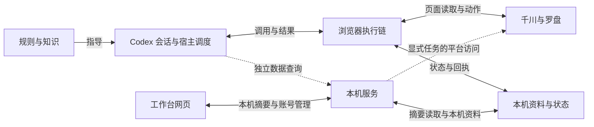

# 文档导航

<!-- architecture-map:begin -->
## 极简项目地图

核对日期：2026-10-12。当前工作树的模块职责与调用关系；以源码入口核对，不代表全部功能或实盘验收。

实线表示现有调用或读写关系；虚线表示按需备用。箭头表示能力关系，不表示当前正在执行。

模块职责与源码入口（Agent 按需展开）

| 模块 | 职责 | 源码入口 |
|---|---|---|
| 规则与知识 | Skill 规定流程与边界；教材、研究和复盘提供按需参考。资料本身不执行投放。 | [SKILL.md](../skills/qianchuan-ops/SKILL.md)、[AGENT_KNOWLEDGE.md](../AGENT_KNOWLEDGE.md) |
| Codex 会话与宿主调度 | 用户给目标和授权；模型判断本轮动作，宿主定时唤醒会话。不是网页或服务端代替模型判断。 | [loop指令.md](../workspace/运行入口/loop指令.md)、[接入与执行.md](../skills/qianchuan-ops/references/接入与执行.md) |
| 浏览器执行链 | 模型读取原始页面、计算和判断，浏览器或独立页面工具执行指定对象及参数，写后按原ID核验。 | [SKILL.md](../skills/qianchuan-ops/SKILL.md)、[脚本索引.md](../skills/qianchuan-ops/references/脚本索引.md) |
| 千川与罗盘 | 外部平台。千川提供广告数据并实际受理投放，罗盘提供经营与流量数据；浏览器和 API 是不同访问路径。 | [qianchuanTabs.js](../server-app/server/lib/qianchuanTabs.js) |
| 本机服务 | HTTP提供本机账户与已存记录；逆向API保留用于历史、素材查询和复盘。 | [server.js](../server-app/server.js)、[liveRoomContext.js](../server-app/server/lib/liveRoomContext.js)、[onboardingGuard.js](../server-app/server/lib/onboardingGuard.js)、[start-workbench.js](../server-app/scripts/start-workbench.js)、[workbenchSnapshot.js](../server-app/server/routes/workbenchSnapshot.js)、[workbenchSnapshot.js](../server-app/server/lib/workbenchSnapshot.js) |
| 工作台网页 | 仅保留多账号总览与账号管理。总览每30秒读本机摘要，账号卡片按需展开并可搜索；网站罗盘数据显示和请求默认关闭、代码保留。各主计划独立展示，隐藏轮次和逐项回执，缺失不补采、过期标历史。 | [index.html](../server-app/server/public/v4/index.html)、[v4.js](../server-app/server/public/v4/v4.js)、[overview.js](../server-app/server/public/v4/pages/overview.js) |
| 本机资料与状态 | 控制器原子保存浏览器场次、轮次及操作回执，服务只读投影供网页展示；账户资料、服务端账本与执行锁仍各自保存，摘要贯通不等于跨通道状态合并。 | [codex-qc-control-state.mjs](../tools/codex-qc-control-state.mjs)、[codex-qc-round-record.mjs](../tools/codex-qc-round-record.mjs)、[config.js](../server-app/server/lib/config.js)、[decisionRounds.js](../server-app/server/routes/decisionRounds.js) |

- 浏览器主链可直接运行，不以工作台网页为前置。API用于历史查询与复盘。
- 总览复用控制器 state.json，不重复写网页台账。只读取配置的运行目录，按广告户、账户及完整场次绑定；同场多份来源保留冲突，不择新冒充权威。
- 正式启动器关闭默认后台采集。网页常规打开、刷新和切页只读本机；用户显式点击账户核验可能访问平台，API用于独立查询。
- 账户、主计划、房间和开播时间是操作绑定；执行归属、未决提交和回读结果必须随通道核验。页面选中账号、文件存在或图上连线都不是执行授权。
- 摘要标注采集时间与口径；过期、未知、未决及执行归属分别展示。历史归属不证明宿主调度当前正在运行，旧控制器文件没有摘要时不自动补采。

支撑目录：plugins/codex 用于宿主分发；checks 与 tools/qc-simulator 用于验证；release 与构建脚本用于交付。DSH 当前不启用。它们不单独构成投放会话。

**待优化方向**：跨通道执行锁、未决和回执仍需原对象核验；工作台不汇总未接入的旧脚本或 MCP 历史账本，也不显示为实时数据。新增来源须单独验证。

核验范围：已核上述源码入口，摘要字段、账户隔离、过期与未知处理及网页本机请求有隔离测试。本图不证明广告动作或本场调度成功。

<!-- architecture-map:end -->

按任务查对应章节。日常盯盘沿用[工作区流程](../workspace/工作区索引.md)与本场记录，无需通读文档库。

| 当前任务 | 唯一正文 | 合并后的内容 |
|---|---|---|
| 用户首次使用、登录和补充信息 | [用户引导](用户引导.md) | 本人操作、缺项问答、千川与罗盘登录资料 |
| Agent 部署或接续 | [客户端接入](客户端接入.md) | 依赖、Skill与浏览器、工作区、账户向导与校准契约 |
| 日常盯盘与追投 | [日常运行](定时与循环任务.md) | 宿主调度、多账号与场次隔离、只读采样、标准追投脚本 |
| 查工具和数据字段 | [逆向API功能图](逆向API功能图.md) | 查询能力、源码索引、归档范围、验证状态 |
| 浏览器读取或追投 | [浏览器操作](浏览器追投工具.md) | 固定业务入口、读取与建议、CDP、DSH 及验收边界 |
| 按自然语言参数调用脚本 | [脚本索引](../skills/qianchuan-ops/references/脚本索引.md) | 独立新建、连续批次、完整调控、参数及中断接续 |
| 查已验证动作、保存新证据 | [浏览器按钮库](浏览器按钮库.md) | 持续更新的动作登记、回读证据与复用规则 |
| 理解系统或定位代码 | [项目架构与代码导航](项目架构与演进路线.md) | 架构、通道选择、演进路线、源码导航 |
| 构建、交付与维护 | [交付与维护](内测交付.md) | 核心包、插件、客户验收、整洁规则、待实现的商业规划 |
| 判断执行权限与正确性边界 | [运行边界](agent-contracts/portable-runtime-policy.md) | Agent 决策、对象绑定、并发、回执及数据质量 |

字段结构单独保留[账户 Profile Schema](agent-contracts/account-profile.schema.json)。平台规则和研究方法从[知识入口](../AGENT_KNOWLEDGE.md)进入；账户参数、操作授权及复盘使用客户自己的当前记录。

## 项目目录怎么分

| 位置 | 用途与保留原则 |
|---|---|
| 根目录五个 Markdown 入口 | README 导航、第一次使用看这个、AGENTS 规则、AGENT_START 部署、AGENT_KNOWLEDGE 知识路由，各自保留一份 |
| docs/ | 当前使用说明和技术契约；同题合并，旧入口回收，不保留跳转文件 |
| plugins/codex/ | Codex 插件的正式适配源码，用于构建和分发；不是插件缓存。是否正在使用须核对实际安装位置，不能凭目录存在判断 |
| skills/qianchuan-ops/ | 随包技能的唯一源码，含规则来源、计算脚本和模板；安装副本沿用[同步流程](客户端接入.md#技能正文与安装副本) |
| .agents/skills/ | 当前项目的技能发现位置；宿主仍可能使用独立安装副本，不因看起来重复就删除 |
| tools/ | 部署、取数、追投、浏览器、构建及维护脚本；被调用时执行，不因文件存在就常驻运行 |
| checks/ | 验证当前代码的测试源码；测试输出按[整洁规则](内测交付.md#项目整洁与测试产物)回收 |
| 复盘报告/ | 客户真实场次报告和交接材料，属于业务记录；旧日期不等于无用，不按测试输出清理 |
| 程序 workspace/ | 通用运行入口、账户知识和空白策略模板；不填入客户答案 |
| 客户工作区 | 本账号与场次的策略、任务、接续和复盘；按真实映射沿用，不共用一份全局状态 |
| private-runtime/ | 本机凭据、账户资料、运行数据与维护回执。docs 中的历史实测和旧需求原文归入 reports/docs-history/，不作为当前规则或发布材料 |
| work/ | 在用浏览器证据、技能同步恢复资料和最终交付包；不累积测试目录 |
| release/ | 发布白名单、脱敏模板与当前构建回执，不是重复源码目录 |
| .gitnexusrc、.gitnexusignore | 可选代码导航配置；生成索引可重建，不能替代当前源码 |
| .git/、.gitignore、.gitattributes、.mcp.json、.codex/ | 版本控制、忽略规则及宿主连接配置；含本机配置的文件不公开分发 |

兼容安装可能把账户资料放在 server-app/config.json、scripts/*cookie*、account-profiles/ 或 onboarding/。以实际 QC_RUNTIME_CONFIG_ROOT 为准，不能只保护 private-runtime。构建只采用 release/files.json 白名单；清理文件不代表宿主调度已停止。
