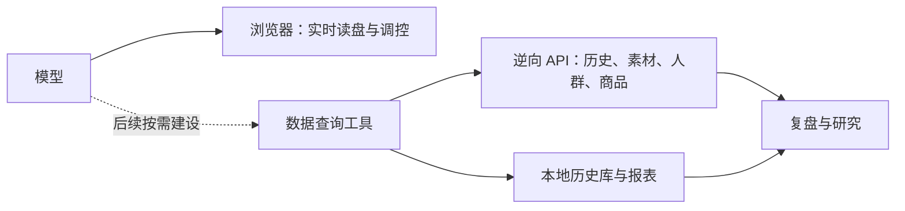

# 逆向 API 功能图

当前分工：日常直播读盘、判断与操作使用浏览器；API 用于独立的数据查询与复盘。用户已另行授权API批量暂停、恢复及预算修改专项验收，尚未迁移日常调度。旧千川 MCP 工具已移除，新数据工具尚未封装。

| 能力 | 能查什么 | 来源 | 建议 |
|---|---|---|---|
| 直播复盘 | 场次、消耗、成交、ROI、渠道趋势 | 千川报表＋本地历史 | 优先保留 |
| 历史数据 | 日期范围、计划表现、日报与趋势 | 千川、抖店 | 优先保留 |
| 素材查询 | 视频库、素材ID、审核和来源、所属计划 | 千川 | 优先保留 |
| 素材效果 | 累计/分时表现、投放记录、生命周期 | 千川＋本地采样 | 优先保留 |
| 追投复盘 | 任务表现、素材组明细、创建/修改记录 | 千川 | 优先保留 |
| 商品与退款 | 商品表现、订单、退款相关指标 | 罗盘、抖店、千川报表 | 按需保留 |
| 人群研究 | 年龄、性别、地域、兴趣、渠道、人群资产 | 千川、罗盘、云图 | 按需保留 |
| 内容研究 | 素材标签、内容分析、脚本结构 | 千川、云图 | 按需保留 |
| 账户查询 | 余额、日预算、追投额度、保障记录 | 千川 | 按需保留 |
| 报表对账 | 导入报表、历史对比、数据核对 | 本地文件与数据库 | 保留；不是平台 API |
| 实时面板接口 | 大屏、近5分钟、当前任务数据 | 千川、罗盘＋缓存 | 保留研究；不用于直播调控 |
| 投放写接口 | 新建、启停、删除、预算、出价、素材修改 | 千川 | 暂停、恢复、预算按明确授权专项验收；其他写入保留研究，尚未接日常调度或MCP |

## 归档能力

| 归档内容 | 实际性质 | 处理 |
|---|---|---|
| 追投时段分析 `boostTimeAnalysis.js` | 本地历史快照按创建小时汇总 | 可用于后续时段复盘 |
| 旧罗盘桥接 `compassWb.js` | 旧浏览器传输通道 | 保留归档，不恢复 |
| 浏览器降级 `browserFallback.js` | 旧账户信息读取通道 | 与现有接口合并去重 |
| `reports.js` | 空报告函数 | 不算已实现能力 |
| 旧 Skill、保障计算资料 | 规则与本地计算 | 保留资料，不算 API |

## 索引与验证范围

- [完整接口与数据集清单](逆向API清单.json)：逐项记录源码路径、行号、当前/归档/文档来源；区分平台路径与本地 HTTP 路由。
- 通用 `statQuery` 按数据集提供多种报表；不能把一个 URL 当作只有一种查询能力。
- 当前清单核验到源码和归档记录，未逐项请求平台。接口是否可用、历史覆盖范围、更新时间和账户权限须在重建对应工具时验证。
- 保留数据返回时间、平台更新时间、查询范围和缓存标记；缺失时标未知，不承诺实时性。
- 本地路由包含管理和历史兼容入口，不等于平台逆向 API；返回退役状态的入口不算可用能力。

维护命令：`python tools/inventory-platform-apis.py`。只扫描代码和文档，不读取账户配置或请求平台。

## 按业务重组 MCP 的候选范围（2026-10-15）

状态：源码审计及分组完成，尚未实现、注册或请求平台验收。Codex 浏览器 MCP/插件仍在，不代表旧千川业务 MCP 仍注册；`mcpClean.js` 是 HTTP 数据投影模块。

| 顺序 | 业务入口 | 可复用实现（相对 `server-app/server`） |
|---|---|---|
| 首批 | 历史场次与单场复盘 | `routes/liveReplay.js` |
| 首批 | 素材查找与历史效果 | `lib/creativeVideoLibrary.js`、`lib/qianchuanTabs.js` |
| 首批 | 本地报表与对账 | `routes/offlineReports.js`、`lib/offlineReports.js`、`lib/db.js` |
| 后续 | 追投任务、素材组和调整记录 | `routes/boostData.js`、`lib/qianchuanTabs.js` |
| 后续 | 商品、成交与退款 | `routes/doudian.js`、`routes/materialRefund.js`、`routes/compass.js` |
| 后续 | 人群与内容研究 | `lib/materialAudience.js`、`lib/yuntu.js`、`lib/qianchuanTabs.js` |
| 后续 | 余额、额度与保障资料 | `routes/balance.js`、`routes/cpaQuota.js`、`lib/qianchuan.js` |

输入：本机账户键、广告户及适用的计划/场次/素材、平台日期范围、所需指标或模块、分页和期限。账户显式绑定并核归属，不跟随前端选择，不把广告户 ID 自动当本机账户键。

输出：原始指标名称与单位、实际范围、来源时间、获取时间、缓存标记、缺项、错误、完整性与覆盖。质量状态复用 `lib/dataContract.js` 的 `fresh/partial/stale/unavailable`；`ok:true` 不代表分页完整或实时数据。各组仅薄封装已有查询模块，不恢复旧策略执行器。

封装前修正：

- `creativeVideoLibrary.js` 的缺指标默认零改为明确缺失；队列取消信号传递到实际请求。
- `qianchuanTabs.js` 的素材详情按所需模块查询，分别返回成功与失败，不固定合并全部趋势、时序、人群和内容。
- 缓存身份核账户、对象、日期和指标口径；明确查询更新本地缓存或画像的副作用。
- 不沿用 `mcpClean.js` 对缓存等质量字段的清除；保留页数、总量、唯一 ID、截断和实际覆盖。
- 复用 `qianchuan.js` 的账户队列、连接复用、期限与错误分类，不另造无限重试。单户失败保留其余账户结果，超时或缺数不补空池或零值。

验收：离线核账户隔离、取消、缺失/零值、部分返回、分页和缓存；随后核真实账户同口径数据、耗时及故障隔离。查询 MCP 不默认启用投放写接口，各房经营规则及主计划禁止删除保持。源码存在或 MCP 注册成功均不算真实业务通过。

## API批量专项验收状态（2026-10-15）

用户授权范围为真实账户的批量暂停、恢复、预算修改及逐项回读。入口、参数、脚本和证据集中在[脚本索引](../skills/qianchuan-ops/references/脚本索引.md#api专项批量验收2026-10-15)，不与查询 MCP 混淆。

已通过：三个广告户已有登录资料的本机同步；三账户调控中池并发读取3轮；胜利一条暂停任务预算100→110→100及原状态恢复，名称、出价和定向等保持。预算接口本次拒绝差额1元，明确要求至少10元。

真实两条预算批量：示例乙60000025、60000026均保持暂停，两次单POST数组分别100→110和110→100，逐ID预算及其他不变量核验通过；每批含预检和回读27.033/27.346秒，提交2.782/2.714秒。最终均100元、原暂停和名称保持，已按用户要求交回示例乙执行会话。

未通过：两条以上真实批量暂停与恢复；同条件浏览器速度对照、完整经营判断及长期稳定性。胜利恢复响应已受理但实际素材删除、任务不能投放，此分支不算恢复成功。其浏览器编辑表单缺原素材，取消后原参数保持，没有浏览器预算提交速度样本。日常调度未由本次验收迁移，仅默认名称条款已更新并回读。

## 历史素材选材

适用房间：示例丙、示例丁。开场选材、扩测或换素材时按需查询；实时调控仍使用浏览器。

| 已有本地只读入口 | 输入 | 范围与限制 |
|---|---|---|
| `GET /api/materials/video-library` | `account,start,end,page,pageSize` | 账户视频库；日期传至平台metricsStartTime/metricsEndTime。包含跨渠道素材指标，核原始raw字段和分页，缺数不使用规范化默认零判断 |
| `GET /api/material-detail` | `account,id,start,end` | 指定素材的日趋势、成交及退款等原字段；源码将结束日期限制到昨天。以实际返回范围为准，缺项不补零 |

- 复用已核实的本地服务地址及账户映射，不默认选择账户，不将广告户ID未经核对当成本机账户键。
- 日期按平台北京时间明确传入；记录查询时间、数据范围、原指标名称及覆盖情况。近7天与15天重叠，不相加，不用重叠汇总直接认定变化趋势。
- 用精确素材ID与当前主计划可投视频相交；不混入同账户其他直播间候选，不将组指标分摊给成员。
- 模型结合样本量、成交效率和可用日趋势决定测试顺序与规模。无历史或低样本不直接淘汰，不增加固定评分、排名阈值或自动投放动作。
- 接口或凭据失败时记录历史缺项，继续现有页面支持的判断；不自动启动旧专用浏览器或导出Cookie。
- 本次已核源码参数与字段范围，尚未对两个账户进行7天/15天平台实测；不保证任意跨度受理或指标完整。不新增MCP、查询调度或控制器。
